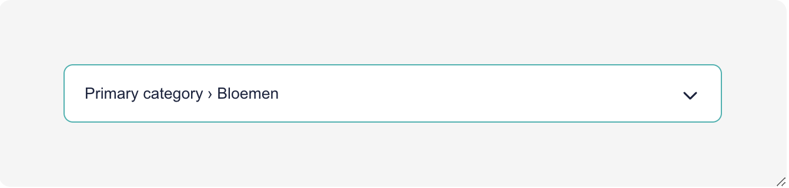
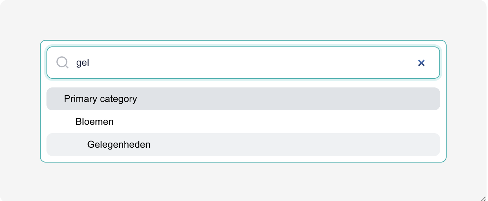

# Commercetools Category Field Plugin

A Storyblok field plugin that lets editors select a single category from a
commercetools project. Categories are shown as a searchable tree, with names in the
language of the story.

## Plugin options

Configure these options in the Storyblok field plugin settings:

| Option            | Required | Description                                                                                     |
| ----------------- | -------- | ----------------------------------------------------------------------------------------------- |
| `projectKey`      | yes      | The commercetools project key                                                                   |
| `clientId`        | yes      | A commercetools API client id                                                                   |
| `clientSecret`    | yes      | A commercetools API client secret                                                               |
| `ancestorKey`     | no       | Only show categories below the category with this key. Without it, all categories are fetched. |
| `baseUri`         | no       | commercetools API URL. Defaults to `https://api.europe-west1.gcp.commercetools.com`.            |
| `defaultLanguage` | no       | Language for category names when the story uses the default language. Defaults to `en`.         |

The API client must have **only** the `view_categories` scope. The token is requested
from `https://auth.europe-west1.gcp.commercetools.com`; other regions are not
supported for authentication.

## Stored data

The plugin stores the selected category in the content field, or `null` when the
selection is cleared:

```json
{
  "id": "4f5c1f3e-0000-0000-0000-000000000000",
  "key": "shoes"
}
```

## Preview

<div style="display:flex;gap:1rem;align-items:flex-start">
  
  
</div>

## Development

Install dependencies from the repository root:

```shell
pnpm install
```

Run the plugin locally:

```shell
pnpm dev
```

Then open the [Storyblok Plugin Sandbox](https://plugin-sandbox.storyblok.com/field-plugin/)
and fill in the options described above.

Other scripts:

```shell
pnpm test   # Vitest
pnpm build  # tsc + vite build
pnpm lint   # Biome
```

## Deployment

Every push to `main` runs the tests, builds the plugin and deploys it to the Storyblok
partner portal as `ct-category` (see `.github/workflows/deploy.yaml`).
